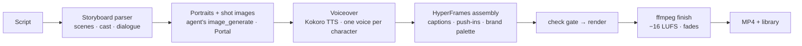

# TVL Studio

**Script in, film out.** Import a script, get a storyboard, generate the images
with your agent, record multi-character voiceovers, and render a finished MP4 —
with one **brand kit** applying a single branding across images, video, text,
voices and music.

A Hermes plugin: agent tools any bot can drive repeatably, plus a TVL-branded
storyboard board in the desktop app (left nav → **TVL Studio**).

## The pipeline



- **Script formats:** screenplay (`INT./EXT.` headings, `CHARACTER: dialogue`,
  `CAST: NAME — description`), markdown scenes, or plain prose (narrated).
- **Characters:** each gets a distinct Kokoro voice and one reference portrait;
  shot images use the portraits as references so characters stay consistent.
- **Brand kits:** dropdown in the board, `studio_brands` for agents. Bundled:
  `tvl` (TVL look on all media) and `script-driven` (default — visuals follow
  the script). A kit = image style-lock + video palette/fonts + voice casting +
  music file. The **app UI is always TVL-branded**; the kit brands the media.
- **Free where it counts:** TTS, assembly, render and finish run locally at $0.
  Only image generation spends Portal credits (via the host's `image_generate`).

## Agent tools

| Tool | Does |
|---|---|
| `studio_import_script` | script → project + storyboard + cast + first next_action |
| `studio_status` | storyboard state + the single next action to perform |
| `studio_attach_image` / `studio_attach_portrait` | attach generated files |
| `studio_voiceover` | Kokoro TTS per line, per-character voices, ffmpeg concat |
| `studio_assemble` | HyperFrames composition → check gate → render → loudness finish |
| `studio_list` / `studio_brands` | projects; brand kits list/save/apply |

The repeatable loop is documented in the bundled skill (`tvl-studio:tvl-studio`).

## Limits (honest)

- 12 Kokoro voices; more characters share voices. No cloning, no lip sync.
- Images: host `image_generate` — 1K/2K, ≤4 reference images, credits apply.
- No generated live-action clips yet (Portal `video_generate` is a later phase);
  motion comes from HyperFrames animation.
- Music: a kit file you own/licence (inside the data dir); no auto-score yet.
- Film length: no hard cap; render time and RAM are the real limits.

## Install

Desktop app → **Capabilities → Plugins → Install from Git** →
`https://github.com/trillionverselabs-boop/tvl-studio` → tick **Desktop** →
Install (leave *Pin to commit* empty while it evolves). Private repo: complete
the one-time Git credential prompt if asked.

Requires on the gateway machine: Node/npx (Hermes ships it), ffmpeg (Hermes
ships it), HyperFrames via npx, and a kokoro-onnx Python for TTS (set
`TVL_STUDIO_TTS_PYTHON` if not at `~/work/arena-demo-video/.venv/bin/python`).

## Verify

```bash
hermes plugins validate . --install-deps   # Validation passed.
PYTHON=<venv with pytest+fastapi> ./scripts/test.sh -q
```

## Licence

MIT. Built on HyperFrames (HeyGen) and Kokoro TTS; orchestration concepts
inspired by Imagination Studio (Keys/drowzeys + Sam Wasserman, Apache-2.0) —
no code copied from it. See CREDITS.md.
